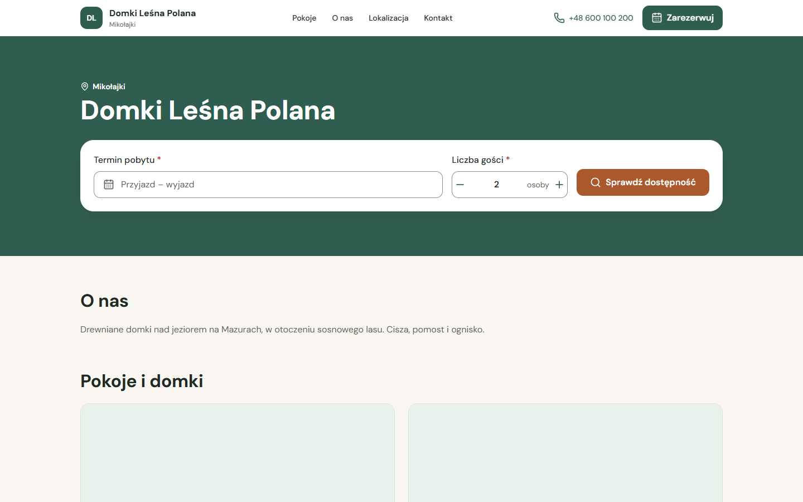
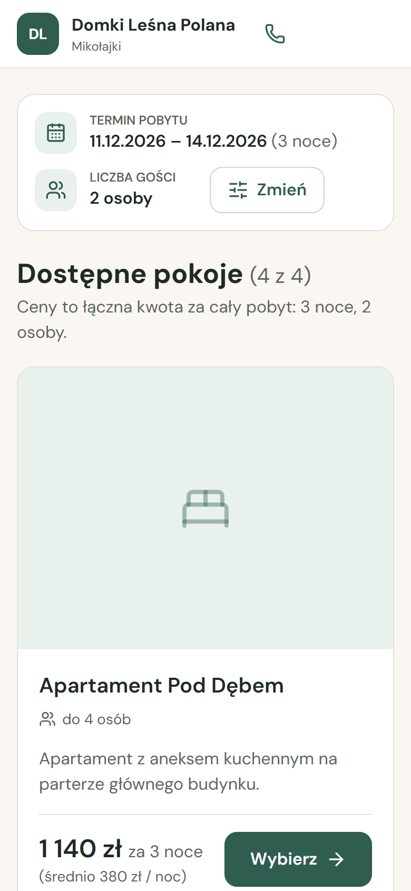
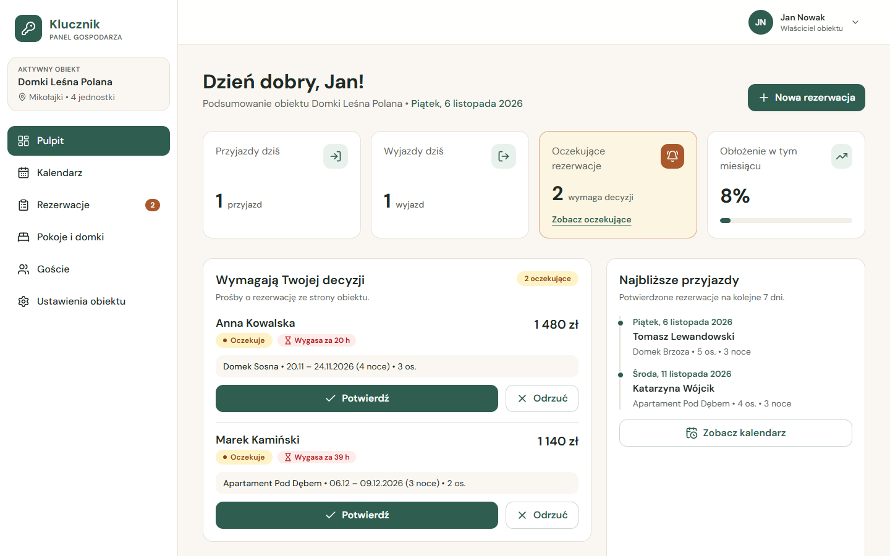
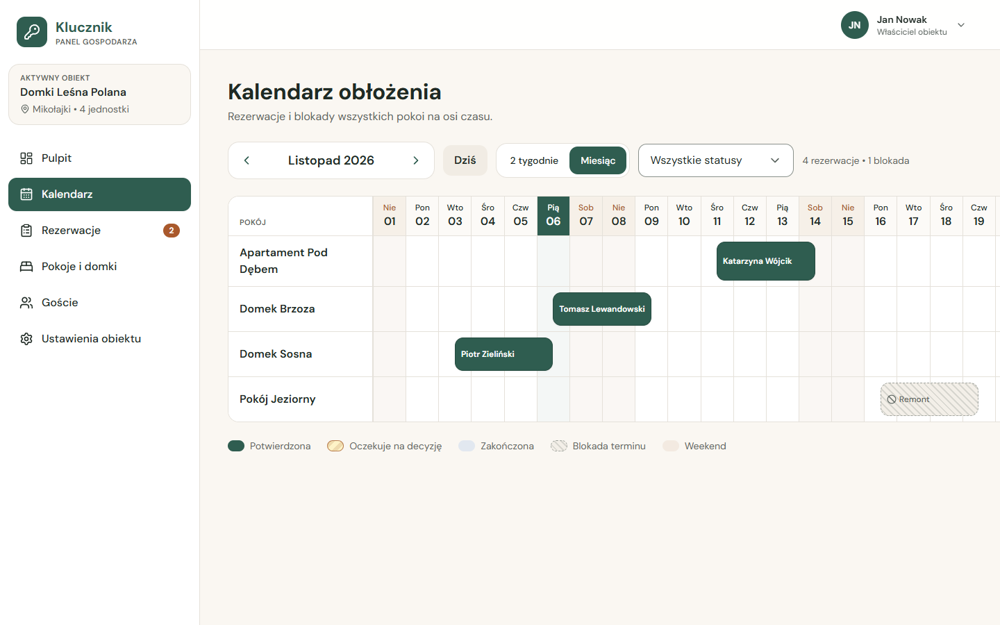
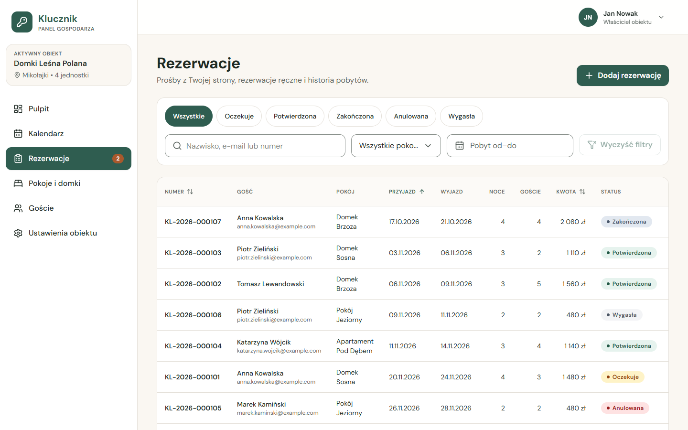
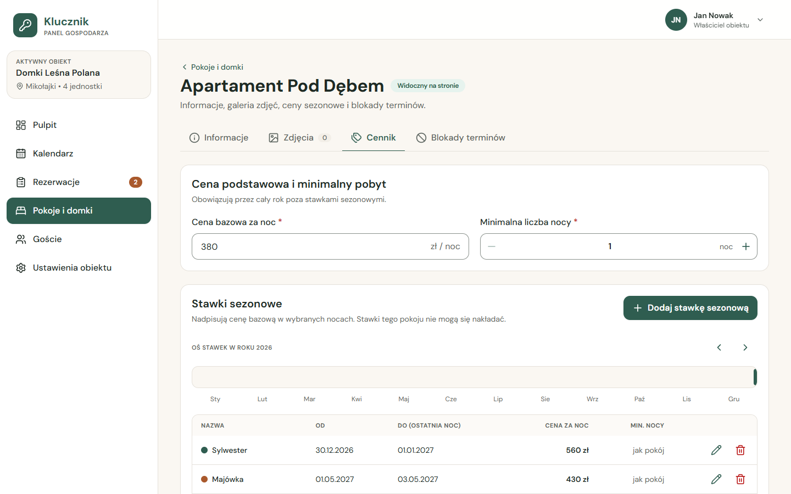
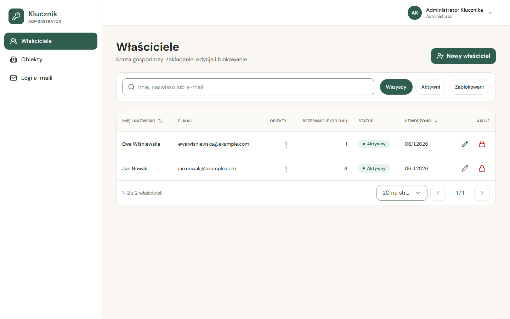
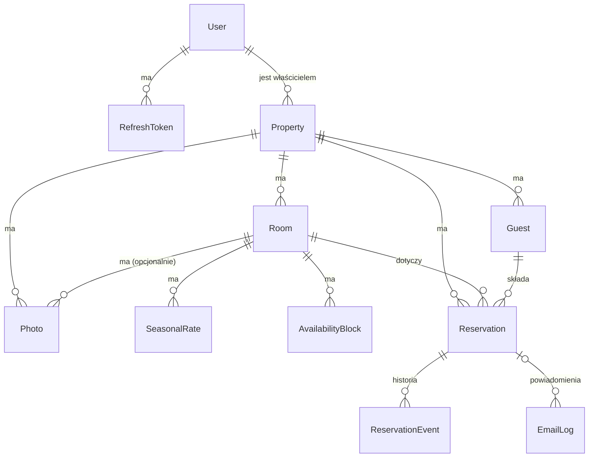

# Klucznik – Twój e-recepcjonista

[](https://github.com/KamilW-git/Klucznik/actions/workflows/ci.yml)

> System rezerwacji i zarządzania dla małych obiektów noclegowych: pensjonatów, domków letniskowych, pokoi gościnnych i agroturystyk.
> Projekt zaliczeniowy z przedmiotu ZTPAI, a jednocześnie projekt portfolio i baza produktu multi-tenant.

**Wersja oceniana:** TODO (tag `v1.0.0`) · **Demo video:** TODO · **Repozytorium:** https://github.com/KamilW-git/Klucznik

## Opis projektu

Goście rezerwują nocleg **bezpośrednio na stronie obiektu**, bez prowizji pośredników. Strona jest white-label: marka obiektu, a Klucznik tylko w stopce. Właściciel zarządza obiektem w **Panelu Gospodarza**: kalendarz obłożenia, potwierdzanie rezerwacji, rezerwacje telefoniczne, cennik sezonowy, blokady terminów. Administrator zarządza kontami właścicieli. Jedna instancja aplikacji obsługuje wielu właścicieli z pełną izolacją danych.

Więcej: [docs/product/vision.md](docs/product/vision.md).

## Technologie

| Obszar | Technologie |
|-|-|
| Backend | NestJS, TypeScript, Prisma ORM + Prisma Migrate, class-validator, @nestjs/swagger, @nestjs/config, JWT + argon2, @nestjs/event-emitter, BullMQ, @nestjs/schedule, nodemailer + Handlebars, @nestjs/throttler, helmet |
| Baza danych | PostgreSQL 16 (constrainty `EXCLUDE USING gist`), Redis 7 (kolejka) |
| Frontend | React, Vite, React Router, TanStack Query, React Hook Form + zod, Tailwind CSS, shadcn/ui, orval (klient z OpenAPI) |
| Testy | Jest, supertest, Testcontainers, Vitest, Testing Library, MSW |
| Infrastruktura | pnpm workspaces (monorepo), Docker Compose, nginx, Mailpit, GitHub Actions |

Uzasadnienia decyzji: [docs/decisions/](docs/decisions/).

## Uruchomienie

Instrukcja sprawdzona na czystym klonie repozytorium. Wymagany jest tylko **Docker z Docker Compose v2**.

```bash
git clone https://github.com/KamilW-git/Klucznik.git
cd Klucznik
cp .env.example .env
docker compose up --build -d
docker compose run --rm migrate pnpm prisma:seed
```

- `.env.example` działa bez zmian lokalnie (`NODE_ENV=development`). Przed wystawieniem aplikacji na zewnątrz zmień wartości `change-me` (hasło bazy, `JWT_ACCESS_SECRET`, hasła kont demo).
- Pierwszy build trwa kilka minut. Migracje bazy wykonuje automatycznie usługa `migrate`, a `api` startuje dopiero po nich.
- Ostatnia komenda wczytuje dane demo (2 obiekty, pokoje, cennik, rezerwacje). Można ją powtarzać.
- Zatrzymanie: `docker compose down` (dane zostają w wolumenach), reset danych: `docker compose down -v`.

| Usługa | Adres |
|-|-|
| Aplikacja (strona obiektu, panele) | http://localhost:8080 |
| Strona demo obiektu | http://localhost:8080/o/lesna-polana |
| Logowanie (panel gospodarza i admina) | http://localhost:8080/logowanie |
| API + Swagger UI | http://localhost:8080/api/docs |
| Mailpit (e-maile wysłane przez aplikację) | http://localhost:8025 |

**Konta demo** (z seeda; hasła to wartości `SEED_ADMIN_PASSWORD` i `SEED_OWNER_PASSWORD` z `.env`):

| Rola | E-mail | Obiekt |
|-|-|-|
| `ADMIN` | `admin@klucznik.local` (`SEED_ADMIN_EMAIL`) | wszystkie |
| `OWNER` | `jan.nowak@example.com` | Domki Leśna Polana (`/o/lesna-polana`) |
| `OWNER` | `ewa.wisniewska@example.com` | Pensjonat Pod Lipami (`/o/pod-lipami`) |

### Tryb deweloperski

Wymaga dodatkowo Node.js 24 i pnpm 11 (`corepack enable`). Usługi pomocnicze działają w Dockerze, a aplikacje na hoście z przeładowaniem:

```bash
pnpm install
docker compose up -d postgres redis mailpit
pnpm --filter @klucznik/api prisma:deploy
pnpm --filter @klucznik/api prisma:seed
pnpm dev
```

API: http://localhost:3000/api/v1 (Swagger: `/api/docs`), web: http://localhost:5173 (Vite przekazuje `/api` do API). Opis kontenerów i zmiennych: [infrastructure.md](docs/architecture/infrastructure.md).

## Główne funkcjonalności

### Strona obiektu i rezerwacja online (gość)

Publiczna, white-labelowa strona obiektu: wyszukiwanie dostępności z ceną liczoną noc po nocy (ceny sezonowe, minimalny pobyt), rezerwacja bez zakładania konta, potwierdzenie e-mailem i zarządzanie rezerwacją (podgląd, anulowanie w terminie) przez bezpieczny link. Widok jest projektowany od 375 px.

| Strona obiektu | Dostępne pokoje (telefon) |
|-|-|
|  |  |

### Panel Gospodarza (właściciel)

Pulpit z przyjazdami, wyjazdami i prośbami do potwierdzenia, kalendarz obłożenia wszystkich pokoi, lista rezerwacji z filtrami, wyszukiwaniem i paginacją, rezerwacja ręczna (telefoniczna), edycja rezerwacji z ochroną przed równoczesną zmianą, pokoje i domki ze zdjęciami, cennik sezonowy, blokady terminów, goście i ustawienia obiektu.



| Kalendarz obłożenia | Rezerwacje |
|-|-|
|  |  |

| Cennik pokoju | Panel admina: właściciele |
|-|-|
|  |  |

### Panel admina

Zakładanie, edycja i blokowanie kont właścicieli (z pierwszym obiektem), lista wszystkich obiektów i log wysłanych e-maili.

### Reguły biznesowe i mechanizmy

- 13 reguł biznesowych z ID `BR-xx`, m.in. brak nakładania się rezerwacji (domena, transakcja z blokadą wiersza i constraint `EXCLUDE` w bazie), pojemność, minimalny pobyt, polityka anulowania, maszyna stanów, optimistic locking i izolacja danych właścicieli: [business-rules.md](docs/architecture/business-rules.md).
- Asynchroniczne e-maile: zdarzenia domenowe po commicie, kolejka BullMQ (Redis) z ponowieniami, 7 szablonów Handlebars, log w bazie: [notifications.md](docs/features/notifications.md).
- Scheduler: wygasanie niepotwierdzonych rezerwacji, zamykanie zakończonych pobytów, przypomnienia przed przyjazdem: [async-and-jobs.md](docs/architecture/async-and-jobs.md).
- Upload zdjęć z kontrolą typu i rozmiaru pliku: [photos.md](docs/features/photos.md).

## Model danych (ERD)

12 encji w PostgreSQL. Diagram pokazuje relacje, a pełny opis pól i constraintów jest w [data-model.md](docs/architecture/data-model.md).



`ReservationCounter` (numeracja `KL-RRRR-NNNNNN`) nie ma relacji. Rezerwacje tego samego pokoju w statusie `PENDING`/`CONFIRMED` nie mogą się nakładać, co pilnuje constraint `EXCLUDE USING gist` na zakresie dat ([BR-01](docs/architecture/business-rules.md#br-01)).

## Dokumentacja REST API

- **Swagger UI:** http://localhost:8080/api/docs (JSON: `/api/docs-json`).
- **Kontrakt OpenAPI w repo:** [packages/api-client/openapi.json](packages/api-client/openapi.json). Na jego podstawie powstaje klient TypeScript frontendu (orval), a CI pilnuje, żeby był aktualny.
- **Konwencje:** prefiks `/api/v1`, JSON w camelCase, daty `YYYY-MM-DD`, kwoty w groszach, paginacja `?page=&pageSize=`, sortowanie `?sort=pole:asc`, jeden format błędu z kodem `code`: [api-conventions.md](docs/architecture/api-conventions.md).

Najważniejsze endpointy (łącznie 49):

| Grupa | Endpointy | Dostęp |
|-|-|-|
| Auth | `POST /auth/login`, `POST /auth/refresh`, `POST /auth/logout`, `GET /auth/me` | publiczne / zalogowany |
| Obiekty | `GET POST /properties`, `GET PATCH DELETE /properties/:id`, `GET /properties/:id/dashboard` | `OWNER` (własne), `ADMIN` |
| Pokoje | `GET POST /properties/:propertyId/rooms`, `GET PATCH DELETE /rooms/:id` | `OWNER`, `ADMIN` |
| Cennik | `GET POST /rooms/:roomId/rates`, `PATCH DELETE /rates/:id` | `OWNER`, `ADMIN` |
| Dostępność | `GET /rooms/:id/quote`, `GET /properties/:propertyId/calendar`, `GET POST /rooms/:roomId/blocks`, `DELETE /blocks/:id` | `OWNER`, `ADMIN` |
| Rezerwacje | `GET /reservations` (filtry, wyszukiwanie, paginacja), `POST /properties/:propertyId/reservations`, `GET PATCH /reservations/:id`, `POST /reservations/:id/confirm`, `POST /reservations/:id/cancel` | `OWNER`, `ADMIN` |
| Goście | `GET /properties/:propertyId/guests` | `OWNER`, `ADMIN` |
| Zdjęcia | `POST /properties/:id/photos`, `POST /rooms/:id/photos`, `PATCH DELETE /photos/:id`, `GET /files/:storageKey` | `OWNER`, `ADMIN` / publiczne (pliki) |
| Strona publiczna | `GET /public/properties/:slug`, `…/availability`, `…/occupancy`, `POST /public/properties/:slug/reservations` | publiczne |
| Rezerwacja gościa | `GET /public/reservations/:token`, `POST /public/reservations/:token/cancel` | token z e-maila |
| Admin | `GET POST /admin/owners`, `GET PATCH DELETE /admin/owners/:id`, `GET /admin/properties`, `GET /admin/email-logs` | `ADMIN` |
| Health | `GET /health` (baza i Redis) | publiczne |

Szczegóły żądań, odpowiedzi i błędów każdego endpointu: [docs/features/](docs/features/).

## Architektura

Monorepo pnpm z trzema pakietami: `apps/api` (NestJS), `apps/web` (React SPA) i `packages/api-client` (kontrakt OpenAPI + wygenerowany klient). Backend jest podzielony na moduły funkcjonalne, a każdy na warstwy `http` (kontrolery, DTO) → `application` (przypadki użycia, polityki dostępu, transakcje) → `domain` (czyste reguły biznesowe) oraz `infrastructure` (repozytoria Prisma, adaptery). W Dockerze nginx serwuje SPA i przekazuje `/api` do API, więc całość działa pod jednym adresem.

Diagram komponentów i przepływ żądania od endpointu do bazy: [overview.md](docs/architecture/overview.md). Bezpieczeństwo (JWT, refresh token w ciasteczku `httpOnly`, role, izolacja danych): [security.md](docs/architecture/security.md).

## Testy

| Rodzaj | Komenda | Stan (M14) |
|-|-|-|
| Jednostkowe API (domena, serwisy, guardy) | `pnpm --filter @klucznik/api test` | 262 przypadki, każda reguła BR ma test |
| Integracyjne API (HTTP → PostgreSQL) | `pnpm --filter @klucznik/api test:int` | 262 przypadki w 19 plikach |
| Frontend (komponenty, formularze, MSW) | `pnpm --filter @klucznik/web test` | 165 przypadków |
| Wszystkie testy jednostkowe | `pnpm test` | – |
| Pokrycie `domain/` | `pnpm --filter @klucznik/api test --coverage` | 93% linii (próg 90%) |

Testy integracyjne uruchamiają PostgreSQL w Testcontainers (wymagany Docker) albo używają bazy z `TEST_DATABASE_URL`. Nazwy testów reguł zaczynają się od ID reguły (`BR-01: …`). CI (GitHub Actions) uruchamia lint, typecheck, wszystkie testy, kontrolę aktualności kontraktu API oraz build i smoke test pełnego stacku Docker. Strategia: [testing-strategy.md](docs/architecture/testing-strategy.md).

## Dokumentacja projektu

Indeks: [docs/README.md](docs/README.md). Mapowanie wymagań przedmiotu: [requirements-mapping.md](docs/product/requirements-mapping.md). Scenariusz demo: [demo.md](docs/demo.md). Wytyczne dla agentów AI: [AGENTS.md](AGENTS.md).
